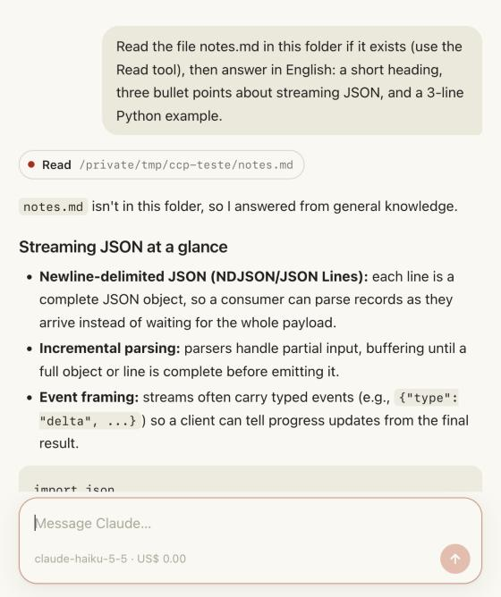
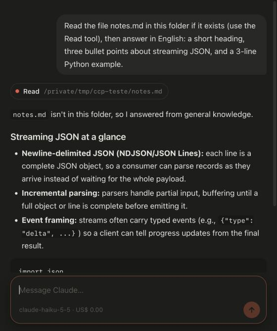

# Claude Chat Panel

A chat panel for Claude Code that you can embed in any app. It is a web page
that renders the session, and a small host that runs the real `claude` CLI
underneath. The host exists in TypeScript, Swift and C#.

| Light | Dark |
|---|---|
|  |  |

This is Claude Code itself, not a raw model call. The session keeps your
skills, MCP connectors, settings, permissions and history. The panel puts a
chat interface over the CLI's structured mode (`claude -p` with `stream-json`
in and out), the same interface the Claude apps and the Agent SDK use. You can
open the same session in a terminal with `claude --resume <id>`.

The page shows:
- answers streaming in Markdown, sanitized;
- code blocks with Copy, and Copy on each answer;
- each tool the session uses, as one line that opens to its result;
- permission requests as Allow, Always allow and Deny;
- Stop, the model and the session's cost;
- the session's past, read from its transcript when the page opens.

## Layout

```
web/            the page: index.html, chat.js, chat.css, bridge.js, vendor/
PROTOCOL.md     page ⇄ host ⇄ CLI, everything a new host needs
hosts/node/     TypeScript: the session library and a test server
hosts/swift/    Swift (macOS): the session and a WKWebView / SwiftUI view
hosts/csharp/   C# (.NET 8): the session and WebView2 glue
examples/       a Swift command-line example
```

Requirements:
- Claude Code installed and signed in (`claude` on the PATH);
- for TypeScript, Node.js 22.6 or newer;
- for Swift, macOS 12 or newer;
- for C#, .NET 8.

## Try it in a browser

```bash
node hosts/node/serve.ts --cwd ~/some/project -- --model haiku
```

Then open the address it prints. Arguments after `--` go to `claude`. Each run
starts a new session unless you pass `--session <uuid>`.

## TypeScript

```ts
import { ClaudeChatSession, newSessionId } from './hosts/node/claude-chat.ts';

const session = new ClaudeChatSession(
  { sessionId: newSessionId(), cwd: '/path/to/project', extraArgs: ['--model', 'sonnet'] },
  event => webContents.executeJavaScript(`window.chat.events(${JSON.stringify([event])})`),
);
// From the page's messages (bridge.js → your IPC):
session.handlePageMessage(message);   // send, stop, perm; copy/link/paste are yours
// When the page says ready:
webContents.executeJavaScript(`window.chat.history(${JSON.stringify(session.history())})`);
```

`hosts/node/serve.ts` is a complete host in 70 lines: HTTP for the page,
Server-Sent Events toward it and POST from it. Run the tests with
`node --test hosts/node/test.ts`.

## Swift (macOS)

Add this repository as a Swift package dependency, then:

```swift
import ClaudeChatPanel

var options = ClaudeChatSession.Options(directory: URL(fileURLWithPath: "/path/to/project"))
options.extraArguments = ["--model", "sonnet"]
let controller = ChatPanelController(session: ClaudeChatSession(options: options))

// SwiftUI
ClaudeChatView(controller: controller)
// AppKit
someView.addSubview(controller.webView)
```

The page ships as a package resource. The controller relays the page and the
session, opens links with `NSWorkspace` and uses the pasteboard.
`swift run claude-chat-demo "question"` runs the session without the page.
Run the tests with `swift test`.

## C# (.NET 8)

```csharp
using ClaudeChatPanel;

var session = new ClaudeChatSession(new(ClaudeChatSession.NewSessionId(), @"C:\path\to\project")
{
    ExtraArguments = ["--model", "sonnet"],
});
// WebView2 (build with -p:WebView2=true):
await webView.EnsureCoreWebView2Async();
var panel = new ChatPanelWebView2(webView.CoreWebView2, session, webFolder: @"path\to\web");
```

`ClaudeChatSession` uses only the base library. `ChatPanelWebView2` serves
`web/` through a virtual host and relays messages in both directions. The C#
host follows the same protocol as the other two, but has not been compiled or
run yet: treat it as a starting point.

## Another language

Read [PROTOCOL.md](PROTOCOL.md). A host is about 150 lines:
1. Start `claude` with the arguments listed there.
2. Write one JSON line per user action.
3. Forward the lines the protocol lists to `window.chat.events`.
4. Read the transcript for `window.chat.history`.

## Theming and words

Every colour is a CSS variable on `:root`: `--bg`, `--text`, `--dim`,
`--faint`, `--accent`, `--accent-text`, `--bubble`, `--surface`, `--outline`,
`--code-bg`, `--danger`, `--ok`. There are also `--font`, `--mono` and
`--column`, the width of the conversation. The defaults are warm neutrals with
a clay accent, light and dark (`prefers-color-scheme`).

The words are English by default. Set `window.CHAT_STRINGS` before `chat.js`
to replace any of them; the full list is at the top of `web/chat.js`:

```js
window.CHAT_STRINGS = { placeholder: 'Mensagem…', send: 'Enviar', stop: 'Parar', allow: 'Permitir' };
```

For web views without clipboard access, set
`window.CHAT_OPTIONS = { hostClipboard: true }`. The page then asks the host
to copy (`copy`) and to paste (`paste`).

## Security

- Model output and tool results are rendered through
  [DOMPurify](https://github.com/cure53/DOMPurify) after
  [marked](https://github.com/markedjs/marked), because they can carry text
  written by third parties.
- Links are never followed inside the page. They go to the host as `link`.
- The test server listens on `127.0.0.1` only.
- Permissions follow your Claude Code settings. The panel only shows the
  requests the CLI sends and passes the answers back.

## License

MIT. `web/vendor/` holds marked (MIT) and DOMPurify (Apache-2.0 or MPL-2.0),
unchanged, with their licenses. See [NOTICE.md](NOTICE.md).
